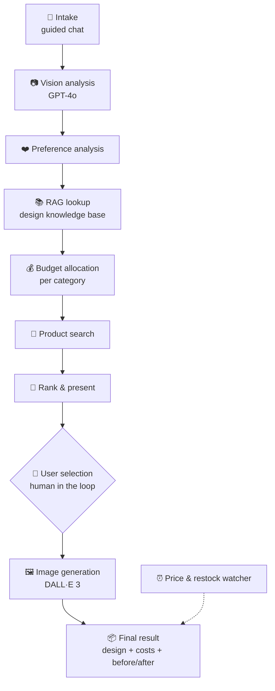

<p align="center">
  
  
  
  
  
  
  
</p>

<p align="center">
  <b>Upload a photo of your room, tell it your style and budget, and a team of AI agents plans a purchase-ready redesign.</b>
</p>

---

## 📑 Contents

- [Overview](#-overview)
- [Problem & motivation](#-problem--motivation)
- [How it works](#-how-it-works)
- [The agents](#-the-agents)
- [Key features](#-key-features)
- [Tech stack](#-tech-stack)
- [Project structure](#-project-structure)
- [Getting started](#-getting-started)
- [Deploy on Render](#-deploy-on-render)
- [n8n workflow integration](#-n8n-workflow-integration)
- [Privacy & security](#-privacy--security)

---

## 📌 Overview

Designing and renovating a room from a photo is hard. People struggle to picture how a new design will look, and many AI design ideas ignore what products actually exist and what they cost.

**Roomly AI** combines:

- 🧠 AI room understanding from a photo
- 🎨 Personalized interior design guided by a design knowledge base
- 💰 Deterministic, category-by-category budget allocation
- 🛒 Product search and multi-criteria ranking
- 🙋 A mandatory **human-in-the-loop** step where you choose the products
- 🖼️ A photorealistic redesign preview
- 📦 A final redesign package with itemized costs and before/after comparison

---

## 🎯 Problem & motivation

**Visual planning is difficult.** Users often cannot picture a redesigned room from descriptions, furniture choices, and colour preferences alone.

**Budget realism is missing.** Many design tools focus on looks and ignore real product prices, which leads to unrealistic plans and surprise costs.

**Our goal:** one AI pipeline that produces a realistic redesign preview, a personalized design proposal, a budget breakdown, and real product recommendations, while respecting the user's budget.

> **From room photo → AI design → real products → your choice → purchase-ready redesign**

---

## ⚙️ How it works

The orchestrator is a state machine that moves every session through ten steps, with a mandatory pause for the user to choose products before any image is generated.



---

## 🤖 The agents

| Agent | File | What it does |
|---|---|---|
| 💬 Intake | `intakeAgent.js` | Guided, multi-turn chat that collects the brief |
| 📷 Vision | `visionAgent.js` | GPT-4o Vision turns the room photo into a structured room analysis |
| ❤️ Preference | `preferenceAgent.js` | Tracks and de-duplicates style, colour, and keep/replace preferences |
| 📚 RAG | `ragAgent.js` | Retrieves interior design guidance from a local vector index |
| 💰 Budget | `budgetAgent.js` | Splits the total budget across categories by room type; kept items get no budget |
| 🛒 Search | `searchAgent.js` | Provider-agnostic product search (SerpAPI, Rainforest, RapidAPI), with built-in fallback data |
| 🏅 Ranking | `rankingAgent.js` | Ranks products on several criteria |
| 🙋 Human-in-the-loop | `hitlManager.js` | Pauses the pipeline until the user confirms the product choices |
| 📐 Placement | `placementAgent.js` | Plans where the chosen items go in the room |
| 🖼️ Image generation | `imageGenAgent.js` | Builds an architectural prompt for DALL·E 3 to render the redesign |
| 📦 Final designer | `finalDesigner.js` | Assembles the final redesign package |
| ⏰ Price watcher | `priceWatcher.js` | Watches prices and stock of chosen items |

---

## ✨ Key features

- **Room understanding:** room type, existing furniture, doors and windows, lighting, dominant colours
- **Design guided by knowledge:** a seeded interior design knowledge base, retrieved per request
- **Budget you can trust:** deterministic allocation, not a guess
- **You stay in control:** nothing is generated until you pick the products
- **Before / after preview** of the redesigned room
- **Bilingual interface:** English and Arabic
- **Works without paid search keys:** built-in fallback analysis and product data for demos
- **n8n workflows** for every step, ready to import

---

## 🛠️ Tech stack

| Area | Tools |
|---|---|
| Backend | Node.js, Express, Multer (uploads) |
| AI | OpenAI GPT-4o Vision, DALL·E 3 |
| Retrieval | Local TF-IDF vector index over a design knowledge base |
| Product search | SerpAPI, Rainforest API, RapidAPI (optional) |
| Workflows | n8n |
| Frontend | HTML, CSS, JavaScript (glassmorphic UI, English / Arabic) |
| Storage | JSON file database with audit log |
| Deploy | Docker, Render |

<p align="center">
  
</p>

---

## 📂 Project structure

```
.
├── render.yaml                         # Render Blueprint (free plan, Docker)
├── Multi-Agent-AI-Home-Design-and-Renovation-Assistant.pptx   # project presentation
└── roomly-ai/roomly-ai/
    ├── n8n-workflows/                  # 9 n8n workflow exports (orchestrator + each agent)
    ├── src/
    │   ├── server.js                   # Express API + n8n webhook bridge
    │   ├── orchestrator.js             # 10-step state machine
    │   ├── agents/                     # the 12 agents listed above
    │   ├── knowledge/                  # design knowledge base + vector index
    │   └── storage/database.js         # persistence + audit log
    ├── public/                         # web app (index.html, style.css, app.js, i18n.js)
    ├── tests/test-pipeline.js          # end-to-end verification
    ├── Dockerfile
    └── .env.example
```

📊 Presentation: [`Multi-Agent-AI-Home-Design-and-Renovation-Assistant.pptx`](Multi-Agent-AI-Home-Design-and-Renovation-Assistant.pptx)

---

## 🚀 Getting started

```bash
cd roomly-ai/roomly-ai
npm install
npm run seed            # build the design knowledge index
```

Create `.env` from `.env.example`:

```env
PORT=3000

# OpenAI API key (vision analysis and DALL·E 3 image generation)
OPENAI_API_KEY=your_openai_api_key_here

# Product search provider keys (optional)
SERPAPI_API_KEY=
RAINFOREST_API_KEY=
RAPIDAPI_KEY=
```

Run it:

```bash
npm start               # open http://localhost:3000
npm run test-pipeline   # end-to-end check
```

---

## ☁️ Deploy on Render

The repo includes a free Render Blueprint (`render.yaml`) that builds the app from `roomly-ai/roomly-ai` with Docker.

1. In Render, choose **New → Blueprint** and connect this repository.
2. Enter `OPENAI_API_KEY` when asked. Add a product-search key only if you want live retailer results.
3. Deploy and check that `https://<your-service>.onrender.com/api/health` returns `"status":"HEALTHY"`.

The free service sleeps after inactivity and clears uploaded photos and sessions when it restarts.

---

## 🔌 n8n workflow integration

1. Open your n8n dashboard (`http://localhost:5678`).
2. Go to **Workflows → Import from File**.
3. Import the files from `roomly-ai/roomly-ai/n8n-workflows/`, starting with `01_roomly_master_orchestrator.json`.
4. Point the webhook / HTTP request nodes to `http://localhost:3000` (or your deployment URL).

---

## 🔒 Privacy & security

- Never commit API keys; keep them in `.env` and document them in `.env.example`.
- Do not commit private room photos or personal information.
- Treat product prices and availability as changing data.


