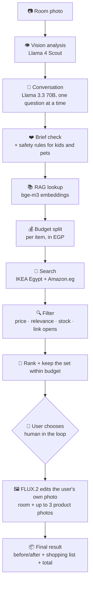

<p align="center">
  
  
  
  
  
  
  
  
  
</p>

<p align="center">
  <b>Upload a photo of your room, chat about your style and budget, and a team of AI agents finds real products sold in Egypt and shows them in your own room.</b>
</p>

<p align="center">
  
</p>

---

## 📑 Contents

- [Overview](#-overview)
- [Problem & motivation](#-problem--motivation)
- [How it works](#-how-it-works)
- [The agents](#-the-agents)
- [Key features](#-key-features)
- [Tech stack](#-tech-stack)
- [Project structure](#-project-structure)
- [Getting started](#-getting-started)
- [Free plan limits](#-free-plan-limits)
- [Deploy on Render](#-deploy-on-render)
- [n8n workflow integration](#-n8n-workflow-integration)
- [Privacy & security](#-privacy--security)

---

## 📌 Overview

Designing and renovating a room from a photo is hard. People struggle to picture how a new design will look, and many AI design ideas ignore what products actually exist and what they cost.

**Roomly AI** combines:

- 🧠 AI room understanding from a photo (empty or with old furniture)
- 💬 A conversation in Egyptian Arabic or English that asks one question at a time: room, what to keep, what to buy, style, colours, household, budget
- 📚 Design rules retrieved by meaning (RAG) for your brief
- 💰 A budget in Egyptian pounds split across the items you asked for
- 🛒 Real products from **IKEA Egypt** and **Amazon.eg**, checked for price, relevance and stock, with every link opened before it is shown
- 🙋 A mandatory **human-in-the-loop** step where you choose the products
- 🖼️ **Your own room photo** furnished with the products you chose
- 📦 A shopping list with prices, store links and the total against your budget

---

## 🎯 Problem & motivation

**Visual planning is difficult.** Users often cannot picture a redesigned room from descriptions, furniture choices, and colour preferences alone.

**Budget realism is missing.** Many design tools focus on looks and ignore real product prices, which leads to unrealistic plans and surprise costs.

**Our goal:** one AI pipeline that produces a realistic redesign preview, a personalized design proposal, a budget breakdown, and real product recommendations, while respecting the user's budget.

> **From room photo → AI design → real products → your choice → purchase-ready redesign**

---

## ⚙️ How it works

Uploading a photo starts the conversation. When the brief is complete, the orchestrator runs the agents in order and pauses for the user to choose products before the room is rendered.



---

## 🤖 The agents

| Agent | File | What it does |
|---|---|---|
| 👁️ Vision | `visionAgent.js` | Describes what is really in the photo: room type, furniture, walls, floor, windows, light |
| 💬 Intake | `intakeAgent.js` | Two steps per message: strict JSON extraction, then a natural reply that asks the next question; the final summary is built in code so it always matches the saved brief |
| ❤️ Preference | `preferenceAgent.js` | Checks the brief is complete and adds safety constraints for children and pets; never invents defaults |
| 📚 RAG | `ragAgent.js` | Finds the most relevant style, layout, colour and safety rules by meaning, in Arabic or English |
| 💰 Budget | `budgetAgent.js` | Splits the EGP budget across the chosen items by weight, with a realistic price range and a search query for each |
| 🛒 Search | `searchAgent.js` | IKEA Egypt and Amazon.eg; drops results outside the price range, accessories (a small model checks each title), out-of-stock items and links that do not open |
| 🏅 Ranking | `rankingAgent.js` | Scores budget fit, colour, style, ratings and store; picks one product per item and swaps until the set fits the budget |
| 🙋 Human-in-the-loop | `hitlManager.js` | Pauses for the user's choice and accepts only products from our own verified results |
| 📐 Placement | `placementAgent.js` | Plans where each chosen item goes |
| 🖼️ Image generation | `imageGenAgent.js` | Sends the user's room photo plus up to 3 product photos to FLUX.2 and describes the smaller items in words |
| 📦 Final designer | `finalDesigner.js` | Builds the shopping list, links and total in EGP |
| ⏰ Price watcher | `priceWatcher.js` | Re-opens watched product pages and records if they are still available |

---

## ✨ Key features

- **Real conversation:** Egyptian Arabic or English, one question at a time, with a live "design brief" card
- **Real products, real prices:** EGP prices from the stores at search time; no invented products or prices
- **Every link checked:** each product page is opened before it is shown
- **Stays within budget:** the recommended set is adjusted until it fits, or the app says honestly that it cannot
- **Your own room:** the after image keeps your walls, window, floor and camera angle
- **You stay in control:** nothing is rendered until you choose the products
- **Free to run, with automatic backups:** Groq, Hugging Face and Cloudflare free plans; if one is busy or out of quota, the next one is used. SerpAPI free plan for Amazon.eg (optional; IKEA Egypt needs no key)
- **No fake fallbacks:** if a key or the daily allowance is missing, the app says so clearly
- **n8n workflows** for every step, ready to import

---

## 🛠️ Tech stack

| Area | Tools |
|---|---|
| Backend | Node.js, Express, Multer (uploads) |
| AI router (`src/ai/index.js`) | Tries free providers in order and switches automatically when one fails |
| Chat & room analysis | Groq Qwen3.8 27B first; Cloudflare Llama 3.3 70B / Llama 4 Scout as backup |
| Room image | FLUX.2 [klein] 9B: Hugging Face Space first (keeps the photo's shape), Cloudflare Workers AI as backup |
| Retrieval | bge-m3 embeddings (Cloudflare, or Hugging Face Inference); keyword matching if neither is available |
| Product search | IKEA Egypt site search, Amazon.eg through SerpAPI, 6–24 h cache |
| Images | sharp (resizing before sending to the models) |
| Workflows | n8n |
| Frontend | HTML, CSS, JavaScript (glassmorphic UI, English / Arabic) |
| Storage | JSON file database with audit log |
| Deploy | Docker, Render |

<p align="center">
  
</p>

---

## 📂 Project structure

```
.
├── render.yaml                         # Render Blueprint (free plan, Docker)
├── Multi-Agent-AI-Home-Design-and-Renovation-Assistant.pptx   # project presentation
└── roomly-ai/roomly-ai/
    ├── n8n-workflows/                  # 9 n8n workflow exports (orchestrator + each agent)
    ├── src/
    │   ├── server.js                   # Express API + n8n webhook bridge
    │   ├── orchestrator.js             # runs the agents in order
    │   ├── ai/cloudflare.js            # one client for chat, vision, embeddings, image editing
    │   ├── agents/                     # the 12 agents listed above
    │   ├── knowledge/                  # knowledge base, embeddings index, item catalogue
    │   └── storage/database.js         # persistence + audit log
    ├── public/                         # web app (index.html, style.css, app.js, i18n.js)
    ├── tests/unit.test.js              # offline tests (npm test)
    ├── tests/smoke-live.js             # full live run with the real APIs (npm run smoke)
    ├── Dockerfile
    └── .env.example
```

📊 Presentation: [`Multi-Agent-AI-Home-Design-and-Renovation-Assistant.pptx`](Multi-Agent-AI-Home-Design-and-Renovation-Assistant.pptx)

---

## 🚀 Getting started

```bash
cd roomly-ai/roomly-ai
npm install
```

Create `.env` from `.env.example` (all keys are free, no credit card). You need at least Groq **or** Cloudflare for chat, and Hugging Face **or** Cloudflare for the image; having all of them gives automatic backups.

```env
PORT=3000

# Groq (chat + room analysis): console.groq.com > API Keys
GROQ_API_KEY=

# Hugging Face (room image; tick "Make calls to Inference Providers" for RAG embeddings):
#   huggingface.co > Settings > Access Tokens
HF_TOKEN=

# Cloudflare Workers AI (embeddings + backup for everything): dash.cloudflare.com
#   Account ID: dashboard home. API token: My Profile > API Tokens > "Workers AI" template
CLOUDFLARE_ACCOUNT_ID=
CLOUDFLARE_API_TOKEN=

# SerpAPI for Amazon.eg (optional; without it only IKEA Egypt is searched): serpapi.com
SERPAPI_API_KEY=
```

Run it:

```bash
npm start          # open http://localhost:3000
npm test           # offline tests, no keys needed
npm run smoke      # full live run: photo → chat → products → image (uses the free quotas)
npm run seed       # only after editing src/knowledge/knowledgeBase.json
```

---

## 🆓 Free plan limits

| Service | Free allowance | What it means |
|---|---|---|
| Groq | ~1,000 requests a day, 7,000 input tokens a minute | Plenty for chat; when busy the app waits a few seconds and retries |
| Hugging Face Space | A few GPU minutes a day (about 5–10 room images) | Each image takes ~30 s; Cloudflare is used if the quota runs out |
| Cloudflare Workers AI | 10,000 neurons a day, reset at 00:00 UTC (02:00 Cairo) | Embeddings and backup. Known issue: the reset is sometimes delayed for hours on Cloudflare's side |
| SerpAPI | 250 searches a month | About 40 sessions a month (one search per item); results are cached for 24 h |
| IKEA Egypt | No key | Uses IKEA's public website search, cached for 6 h |

Notes:
- The after image is an AI preview. It keeps your room but the products may look slightly different from the real ones.
- Prices and availability come from the stores at search time and can change.
- The IKEA search is the same public endpoint the IKEA website uses; it is not an official API and could change.

---

## ☁️ Deploy on Render

The repo includes a free Render Blueprint (`render.yaml`) that builds the app from `roomly-ai/roomly-ai` with Docker.

1. In Render, choose **New → Blueprint** and connect this repository.
2. Enter `CLOUDFLARE_ACCOUNT_ID`, `CLOUDFLARE_API_TOKEN` and (optionally) `SERPAPI_API_KEY` when asked.
3. Deploy and check that `https://<your-service>.onrender.com/api/health` returns `"status":"HEALTHY"`.

The free service sleeps after inactivity and clears uploaded photos and sessions when it restarts.

---

## 🔌 n8n workflow integration

1. Open your n8n dashboard (`http://localhost:5678`).
2. Go to **Workflows → Import from File**.
3. Import the files from `roomly-ai/roomly-ai/n8n-workflows/`, starting with `01_roomly_master_orchestrator.json`.
4. Point the webhook / HTTP request nodes to `http://localhost:3000` (or your deployment URL).

---

## 🔒 Privacy & security

- Never commit API keys; keep them in `.env` and document them in `.env.example`.
- Do not commit private room photos or personal information.
- Treat product prices and availability as changing data.


